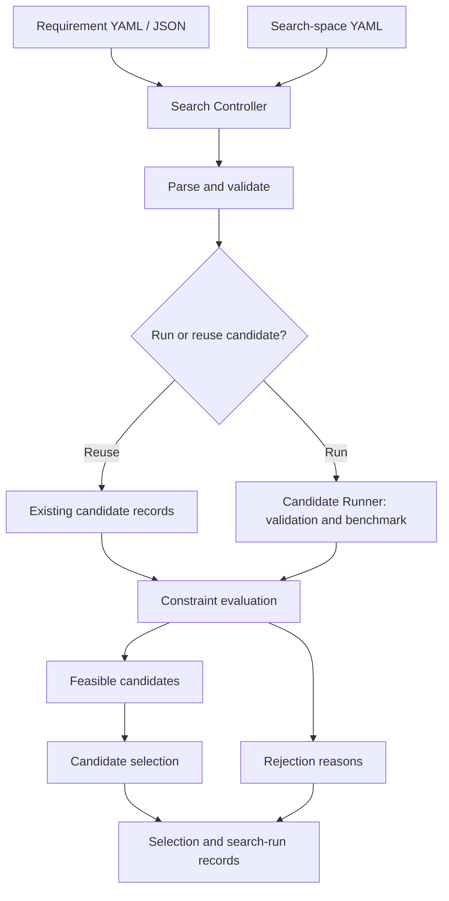
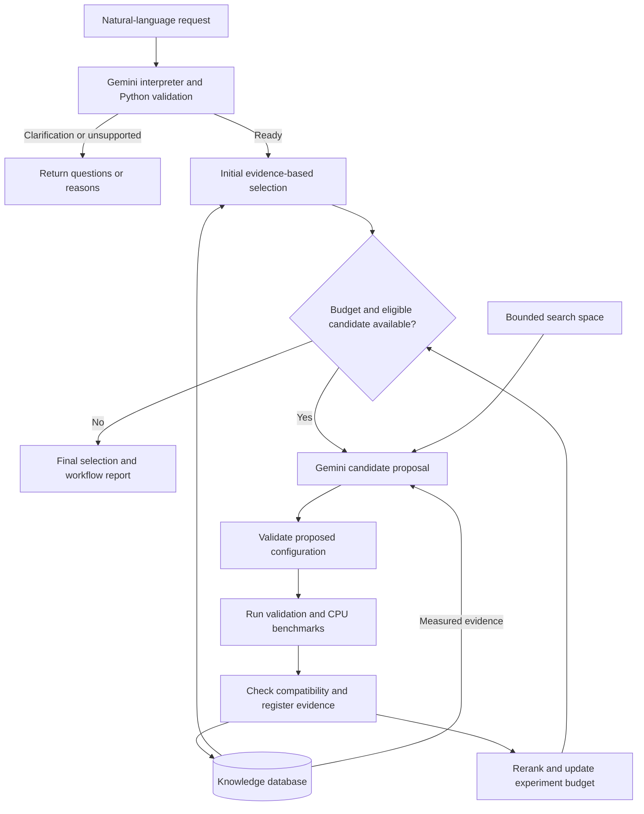
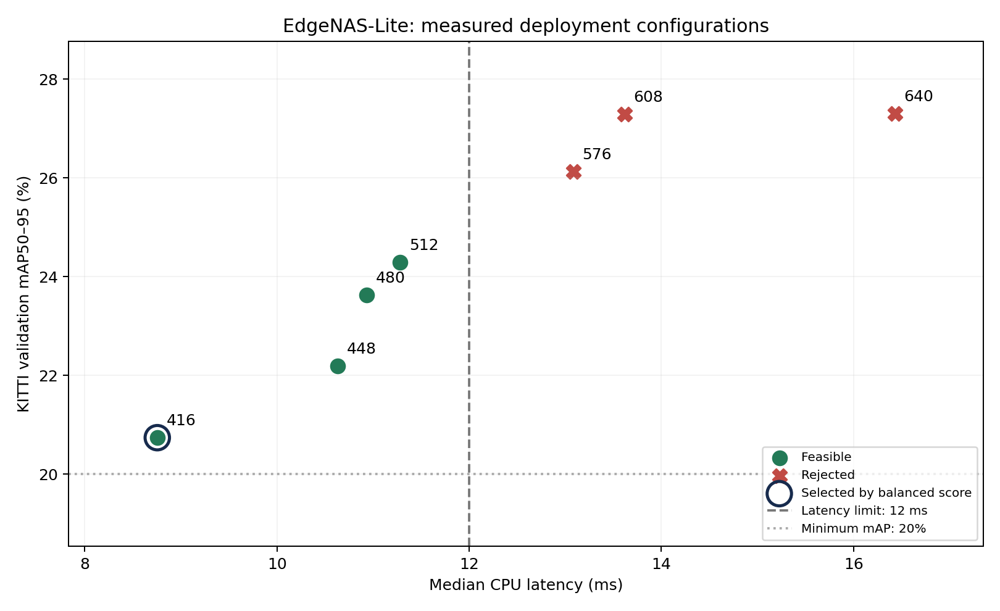

# EdgeNAS-Lite

**LLM-assisted, hardware-aware YOLO deployment-configuration selection.**

[System design](#system-design) · [Results](#final-pilot-result) · [Evidence](#validation-and-evidence) · [Setup and usage](SETUP_AND_USAGE.md)

## Current status — 25 October 2026

[PR #1](https://github.com/doquangminh03/EdgeNAS-Lite/pull/1) is merged into
`main` at `8fe37931bd5194e499af371d07f88aee5ddfeab1`. The implementation branch
`fix/portfolio-readiness` is retained. [GitHub Actions core and full](https://github.com/doquangminh03/EdgeNAS-Lite/actions/runs/40107248046)
both passed for PR head `00923dedf47c6deb36c9c585e31b5eb091d41a6e`.
The local full suite passed **235 tests**; real checkpoint integration and a new
35-run CPU campaign verified the requested 1-thread setting.

The default demo still replays the **archived seven-candidate index** and selects
416 from four feasible candidates. The new campaign is separate latency-only
evidence; it has not replaced archived accuracy or been promoted into the index.
Expanded live LLM evaluation, historical training/data lineage and repository
license selection remain open. See the [current roadmap](EdgeNAS-Lite_Progress_Roadmap.md).

## Quickstart: archived evidence, no API

Using a Python 3.9 interpreter (tested on macOS ARM64):

```bash
python3 -m venv /tmp/edgenas-demo
source /tmp/edgenas-demo/bin/activate
python -m pip install -r requirements-demo.txt
python -m src.proposal.cli configs/requests/low_latency_balanced_demo.yaml --hardware-id local_mac_cpu_01 --model-family YOLO26 --output /tmp/edgenas-selection.json
```

Expected archived result: 7 evaluated, 4 feasible, resolution 416 selected.
Use a new output filename on each run. This replays original target evidence;
it does not benchmark the computer running the command.

[Remediation handoff](docs/PORTFOLIO_REMEDIATION_REPORT.md) ·
[Replay, remeasure and retrain](docs/REPRODUCIBILITY.md) ·
[License decision pending](docs/LICENSE_STATUS.md)

## What is EdgeNAS-Lite?

Choosing an object detector for deployment involves competing requirements: sufficient detection accuracy, acceptable inference latency, and a model that fits the storage budget. A configuration with higher accuracy may exceed the latency limit, while a faster configuration may miss the accuracy target. EdgeNAS-Lite makes this trade-off explicit and selects a configuration using measured evidence.

The project is intended for developers exploring how to turn deployment requirements into an auditable model-configuration decision. It combines an LLM interface with a conventional evaluation pipeline so that a request can be traced to concrete measurements and a repeatable selection rule.

A user supplies requirements in natural language or structured YAML/JSON. The system checks those requirements, retrieves compatible candidate measurements, optionally runs additional experiments within a budget, and ranks the candidates that satisfy every hard constraint. The output includes the selected configuration, measured metrics, ranking, and reasons for rejecting alternatives.

Gemini provides the language interface and proposes which eligible configuration to evaluate next. Python implements validation, experiment execution, compatibility checks, and the final selection policy. Accuracy and latency come from model evaluation and benchmarks; they are not generated by the LLM.

The current prototype studies **one trained YOLO26n checkpoint, KITTI, CPU deployment, and seven input resolutions: 416, 448, 480, 512, 576, 608, and 640**. A candidate is the checkpoint evaluated at a particular input resolution, with no retraining between candidates. This is a bounded deployment-configuration search prototype; architecture-level neural architecture search is outside the implemented scope.

## What the system delivers

- **Requirement interpretation:** convert natural language into validated constraints, or return clarification questions for incomplete or conflicting requirements.
- **Evidence reuse:** retrieve stored measurements and check selected protocol metadata and target hardware identity before selection.
- **Budgeted exploration:** propose an unmeasured resolution from the allowed pool, execute validation and CPU benchmarks, and register the resulting evidence.
- **Constraint-based selection:** enforce accuracy, median-latency, and model-size limits, then rank feasible candidates according to the requested optimization goal.
- **Traceable results:** retain candidate metrics, benchmark samples, proposal rationale, and selection reports for inspection.

## System design

The system has two orchestration paths that use the same underlying ideas: validate inputs, run or reuse measurements, enforce constraints, select a candidate, and preserve the evidence. The structured Search Controller and the LLM workflow are separate entry points.

### 1. Structured search pipeline

Requirement YAML/JSON defines the target and constraints. Search-space YAML defines the fixed model and dataset settings, allowed resolutions, and experiment budget.



The controller enforces hard constraints before ranking. A run with no feasible candidate produces a no-selection result with the available evaluation evidence. The structured proposal CLI also supports selection directly from the knowledge database, without a Gemini call.

### 2. Natural-language workflow and experiment loop

Gemini interprets the request; Python validates the interpretation. The workflow first selects from compatible stored evidence, then optionally explores new configurations through the Budget and Experiment Controllers.



The second diagram shows the successful experiment path. Invalid proposals or execution failures are reported; they are not treated as successful measurements. The workflow stops for clarification and requires a new request rather than continuing an interactive conversation.

**Responsibility boundary:** Gemini interprets intent and proposes an allowed experiment. Python checks eligibility, performs measurements, enforces constraints, and determines the final ranking. The LLM does not supply benchmark values or override failed constraints.

All seven resolutions are already measured in the current index. Changing a request can change the selected candidate, but a positive budget does not force new measurements when the pool is exhausted.

### Main components

| Component | Role | Implementation / data |
|---|---|---|
| Requirement and search-space parsers | Validate constraints, fixed settings, and allowed resolutions | `src/requirement_parser/`, `src/search_space/` |
| Gemini interpreter and proposer | Interpret natural language and propose eligible experiments | `src/llm_agent/` |
| Workflow, Experiment, and Budget Controllers | Coordinate initial selection, experiment slots, registration, and reranking | `src/llm_agent/` |
| Knowledge database | Store references to measured candidates and retrieve evidence | `src/knowledge_database/`, `knowledge/index.yaml` |
| Candidate Runner | Validate model accuracy and benchmark CPU latency | `src/candidate_runner/` |
| Compatibility-gated proposal | Check target/protocol eligibility and assemble selection results | `src/proposal/` |
| Evidence and reporting | Preserve metrics, raw benchmark samples, rankings, and figures | `results/`, `scripts/` |

## Example input and output

An example request is: “I need object detection on KITTI using CPU, with mAP50–95 of at least 0.20, median latency at most 12 ms, and model size at most 6 MB. Use balanced optimization.”

| Input | Meaning |
|---|---|
| Accuracy, latency, and size limits | Hard constraints that every selected candidate must satisfy |
| Optimization goal | Ranking preference among feasible candidates |
| Hardware ID | Identity of the target associated with the benchmark evidence |
| Experiment budget | Maximum experiment slots; zero selects from existing evidence |

The output is a selection report containing the candidate ID, measured metrics, feasible-candidate ranking, and failed constraints for rejected candidates. The natural-language workflow also saves the interpreted requirement and run status. If no candidate satisfies the constraints, it reports that outcome without silently relaxing the requirements.

## Final pilot result

**Archived demo (`cpu_v1`)**: this table and the 7-candidate / 4-feasible / 416
selection use the unchanged archived index. They do not use the new verified
1-thread campaign. Its latency-only results and provenance are documented in
[THREAD_CONTROL_FIX.md](docs/THREAD_CONTROL_FIX.md); no new accuracy/latency
selection or index promotion has been performed.

For **mAP50–95 ≥ 0.20**, **median CPU latency ≤ 12 ms**, and **model size ≤ 6 MB**, with the `balanced` goal, the system evaluated **7 candidates**, found **4 feasible**, and selected **416**.

| Input resolution | mAP50–95 | Median CPU latency (ms) | Outcome |
|---:|---:|---:|---|
| **416** | **0.207384** | **8.754** | **Selected** |
| 448 | 0.221918 | 10.628 | Feasible |
| 480 | 0.236280 | 10.934 | Feasible |
| 512 | 0.242931 | 11.279 | Feasible |
| 576 | 0.261257 | 13.082 | Exceeds latency limit |
| 608 | 0.272838 | 13.616 | Exceeds latency limit |
| 640 | 0.273000 | 16.429 | Exceeds latency limit |

All candidates use the same **5.102 MB** checkpoint, trained for 10 epochs on 25% of KITTI training data. Accuracy was evaluated on 1,496 validation images for car, pedestrian, and cyclist. CPU timing includes preprocessing, inference, and postprocessing, excluding disk I/O.

The selected candidate is `yolo26n_kitti_pilot_imgsz416_cpu`, with a balanced score of **0.143132**. Feasible candidates receive the mean of three normalized headroom components: accuracy above its minimum, latency below its maximum, and model size below its maximum. Under this policy, 416 has the highest score; 512 has the highest accuracy among the feasible candidates. Model size is constant throughout this pool. Equal weights do not equalize practical influence: accuracy is normalized by the distance from the minimum to 1, whereas latency is normalized by its limit. File size is not runtime RAM or peak activation memory. The legacy policy and deterministic tie-break (score, accuracy, latency, size, candidate ID) are preserved. New sensitivity/Pareto results are in the remediation report and do not alter this default.

CPU benchmarking uses 100 validation images, batch size 1, and five sessions. The first two sessions are excluded for stabilization; the final three contribute 900 pooled latency samples. The demo constraint uses median latency, while P95 is retained in the records.

**Outcome:** the prototype completed the requirement-to-selection pipeline and produced a traceable configuration choice that satisfies the pilot constraints. The result is a selected deployment configuration and its evidence, not a newly designed network architecture.



## Validation and evidence

- **235 software tests passed locally**, including finite-value validation,
  orchestration compatibility, CPU backend-reset regressions and campaign
  thread-evidence rejection. These tests do not measure live LLM quality.
- **GitHub Actions core and full passed** for the merged PR head `00923ded…`.
  The core job exercised lightweight dependencies, core regressions and the
  archived 7/4/416 demo. The full job installed the pinned ML dependencies,
  passed `pip check` and ran the full test suite. [CI run](https://github.com/doquangminh03/EdgeNAS-Lite/actions/runs/40107248046).
- A fresh local PyYAML-only environment ran the archived demo and core checks.
  The earlier **211-test clean-environment** and fresh-clone verification at
  `b6adb98` remain historical evidence, separate from the 235-test follow-up.
- Real checkpoint integration verified backend setup **7 threads → enforce 1**,
  then warmup and all six timed prediction boundaries remained at 1.
- Campaign `threads1_fixed_20261024` completed **35 runs / 10,500 raw samples**;
  all timed sample boundaries recorded requested/observed = 1. Sessions 3–5
  retained 6,300 samples total, 900 per resolution. Source, asset and raw-sample
  verification is [recorded here](results/remediation/thread_fix_20261024/campaign_verification.json).
- The earlier `continuation_measured_v2_20261024` campaign requested 1 thread
  but recorded 7. It is preserved and explicitly **not valid as 1-thread evidence**.
- The **36 newly labelled language cases remain NOT_RUN live**. Search replay
  and exploratory historical trials have **not established an LLM advantage**
  over simple baselines. No new paid API evaluation was performed.

[Archived portfolio evidence](results/portfolio/demo_v1/REPORT.md) ·
[Thread fix and new campaign](docs/THREAD_CONTROL_FIX.md) ·
[Remediation audit](docs/REMEDIATION_AUDIT.md) ·
[Historical clean-environment report](results/reproducibility/clean_env_001/report.json)

## Scope and limitations

Results cover one checkpoint, one dataset, and one target machine. Historical benchmarks span software versions, so latency differences are not a controlled resolution-only comparison. Hardware identity is operator-supplied, and compatibility checks do not establish full environment equivalence. Cross-machine reproducibility and architecture search have not been demonstrated.

## Documentation

See [SETUP_AND_USAGE.md](SETUP_AND_USAGE.md) for installation, API-free selection, natural-language requests, optional experiments, and report locations.

Built with Ultralytics YOLO, KITTI, and Google Gemini. Their software, data, weights, and services remain subject to their respective licenses and terms.

## Continuation tooling

- `python scripts/benchmark_campaign.py --help`: preflight or execute a seeded, five-session campaign, with checkpoint/image hashes and raw timing evidence. Completed campaigns are separate from archived indexed candidates.
- `python -m scripts.analyze_selection --output NEW.json`: predefined weight sensitivity, Pareto frontier and equal-budget archived search replay across four requirements and five random seeds. LLM trials remain NOT_RUN unless separately executed; `--live --model MODEL --max-calls 60` enables the same reveal protocol only after API budget authorization.
- `python -m scripts.evaluate_language --output NEW.json`: 36 pre-labelled held-out cases, with absent responses marked NOT_RUN. Mock tests do not measure live interpretation quality.
- `python -m scripts.verify_offline_demo --output-dir NEW_DIRECTORY`: balanced, accuracy, no-feasible, hardware mismatch, strict archived rejection and missing metadata checks.
- Proposal `--strict-comparison` rejects records missing complete, equal comparison provenance. The default preserves the historical demo policy. Search Controller execution now requires `--hardware-id` and shares that pilot compatibility gate.

## Current workflow and next steps

1. **Replay:** install `requirements-demo.txt`, submit a structured YAML/JSON
   request and select from archived records. No Gemini key, dataset or weights
   are needed. Use a unique output filename; generated demo outputs stay local
   unless deliberately reviewed for inclusion.
2. **Remeasure:** install the full dependencies, supply matching local assets,
   run campaign preflight and execute with a new run ID. `cpu_campaign_v2` /
   `cpu_threads_v2` initialize the backend before enforcing threads and reject
   missing or mismatched thread observations. Preserve raw results and hashes.
3. **Validate before promotion:** collect corresponding accuracy evidence and
   adequate checkpoint/dataset/environment provenance before creating replacement
   candidates or updating `knowledge/index.yaml`. Campaign completion alone does
   not authorize combining new latency with archived accuracy.
4. **Optional live LLM work:** authorize a separate API spending budget before
   running the prepared evaluators. Experiment-slot limits are not monetary
   limits. Keep unexecuted cases marked NOT_RUN and human clarification review
   distinct from the existing agent review.

No repository license has been selected. Follow
[LICENSE_STATUS.md](docs/LICENSE_STATUS.md) before making redistribution claims.
Exact historical conversion/split/subset recovery, retraining reproducibility
and evidence for LLM search superiority remain unfinished research work.

The [final commit review](docs/FINAL_COMMIT_REVIEW.md) records the preparation
before PR #1 was committed, pushed and merged; its “not yet committed” statements
are historical snapshots. Current release state is summarized above. Full
commands and reproduction levels are in [SETUP_AND_USAGE.md](SETUP_AND_USAGE.md)
and [REPRODUCIBILITY.md](docs/REPRODUCIBILITY.md).
